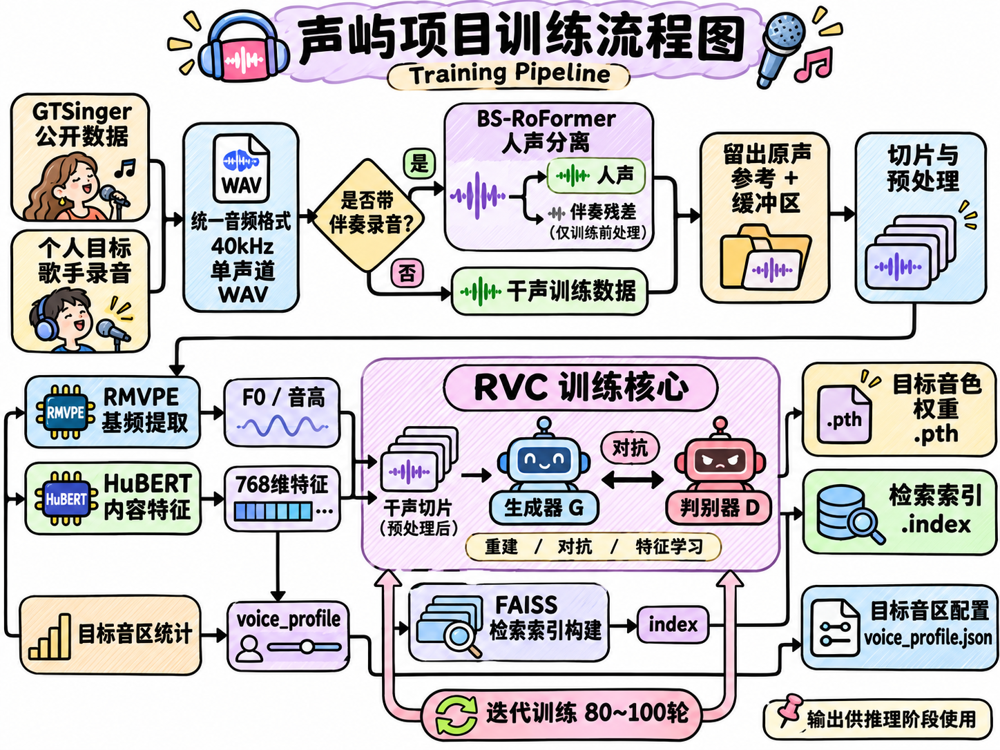
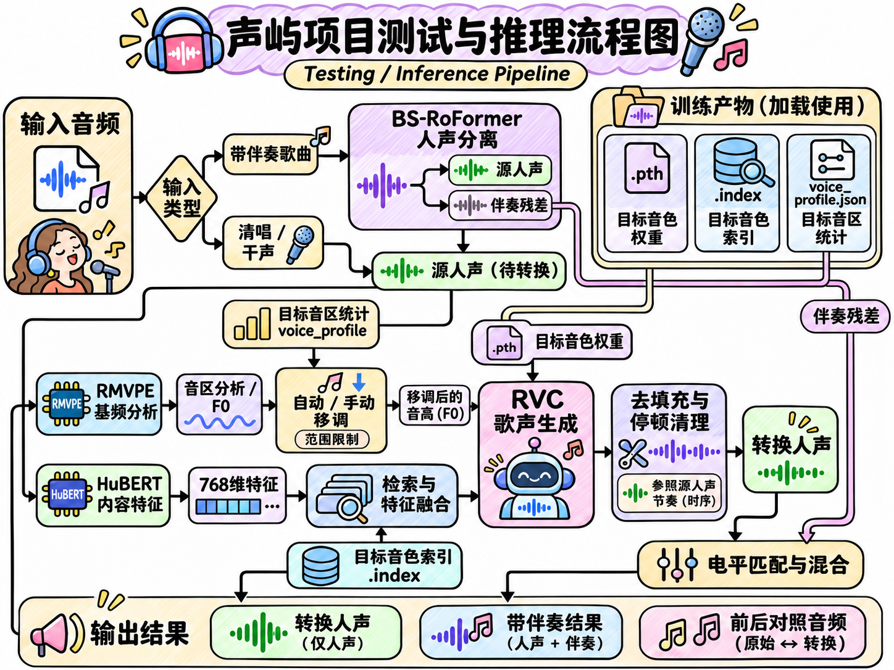

# 声屿 · 歌声转换工作台

声屿把一段歌声换成选定的目标音色。输入清唱时直接转换人声；输入带伴奏的歌曲时，先分离人声和伴奏，再把转换后的人声混回原曲。网页在本机运行，通过 SSH 调用 GPU 服务器推理。

## 项目流程

### 训练流程

### 测试与推理流程

## 模型下载

从 [v1.0.0 下载页](https://github.com/Voice26/shengyu-voice-studio/releases/tag/v1.0.0) 选择需要的模型包，解压到项目根目录。每个包都带有对应的 `models/` 路径。

| 文件 | 内容 |
| --- | --- |
| `personal_20261110.zip` | 个人音色第二版，使用 6 段录音训练 80 轮，包含权重、检索索引和音区配置 |
| `personal_20261109.zip` | 个人音色第一版，使用 3 段录音训练 80 轮，包含权重、检索索引和音区配置 |
| `gtsinger_zh_alto.zip` | GTSinger 中文女声模型，训练 100 轮，包含检索索引和配置 |
| `separation.zip` | BS-RoFormer 分离权重和配置，供带伴奏歌曲使用 |

`SHA256SUMS.txt` 用于校验下载包。[模型文件清单](MODEL-FILES.json) 给出解压后每个模型文件的大小和 SHA-256。个人训练录音不随模型分发。如需在归档版网页试听个人原声，可以把自己的短录音放在对应音色目录的 `reference.wav`。

## 启动工作台

1. 在 Windows x64 电脑上，将[当前项目 ZIP](https://github.com/Voice26/shengyu-voice-studio/archive/refs/heads/main.zip) 解压到可写的文件夹，双击 **配置换声环境.bat**。它会复用可用的项目 Python 环境；首次在新电脑上安装时，会联网下载经过 SHA-256 校验的便携 Python 和网页音频依赖，保存在项目目录内，无需手动设置 PATH。
2. 配置窗口中，按回车沿用 GPU 服务器，或输入 `S` 设置自己的 SSH 别名和 Linux 项目目录。脚本会检查本地模型、SSH 客户端和远端推理环境。要实际换声，服务器需先部署 RVC、基础资源和对应模型，本机需能免密 SSH 登录。详见[服务器运行说明](docs/server_runbook.md)。
3. 双击 **启动换声平台.bat**，打开本机工作台 `http://127.0.0.1:7866`。用完双击 **停止换声平台.bat**。迁移时复制或重新解压整个项目，在新位置再运行一次环境配置即可。参数和历史页用法见[工作台使用说明](docs/platform_runbook.md)。

## 训练与数据来源

[训练流程](docs/implementation_plan.md)介绍了歌曲留出、特征提取和个人音色训练。[跨歌手实验](reports/cross_speaker_test.md)记录了两段公开干声的转换参数和结果。

公开示例来自 [GTSinger](https://huggingface.co/datasets/GTSinger/GTSinger)，数据许可与附加条款见[原文](docs/dataset_license.md)。项目内的 [RVC 源码](third_party/RVC-WebUI)沿用[上游许可证](third_party/RVC-WebUI/LICENSE)。伴奏分离权重的来源、版本和哈希见[资源清单](reports/separation_assets.json)。
