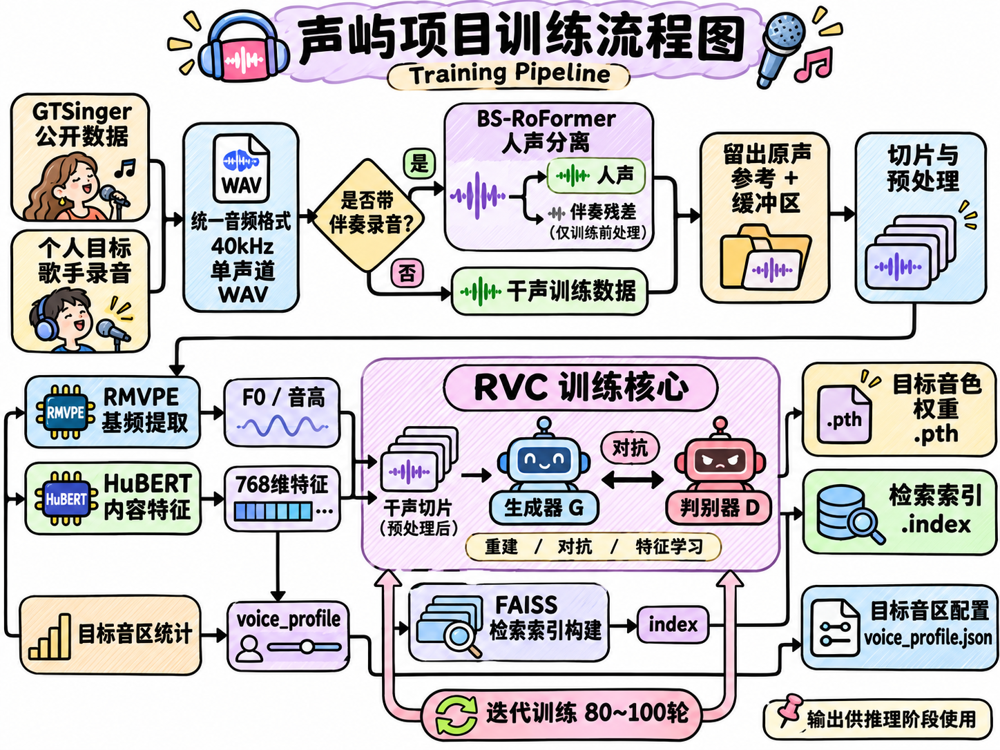
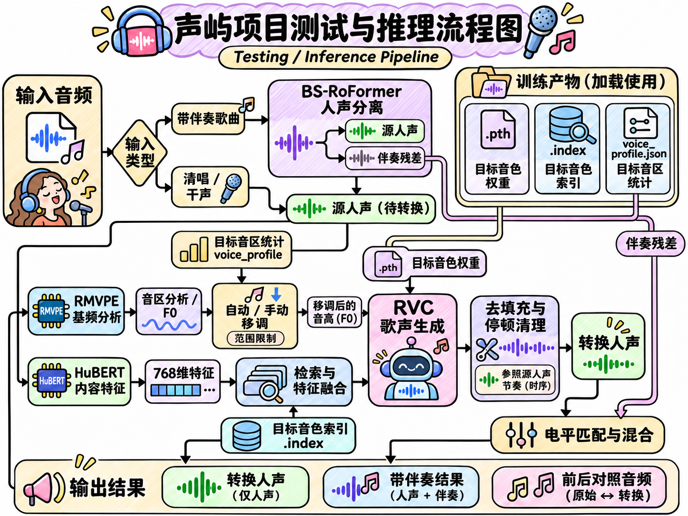

# 声屿 · 歌声转换工作台

[English](README.md) · **简体中文**

声屿基于 RVC，将一段歌声转换为选定的目标音色。输入清唱时直接转换人声；输入带伴奏的歌曲时，先分离人声和伴奏，再把转换后的人声混回原曲。

网页支持**简体中文和英文**，提供音频上传、目标音色选择、音高调整、试听、下载，以及独立的最近生成页面。音频处理由配置好的 GPU 服务器完成。

## 使用界面

1. 上传歌曲或人声录音，也可以先选择准备好的示例。
2. 有乐器和伴奏的音频选择**带伴奏歌曲**，清唱选择**纯人声 / 干声**。
3. 选择目标音色。音色支持时，默认开启自动音区适配和静音优化。
4. 点击**开始换声**，完成后可试听原始人声、转换人声、音量匹配对比，以及带伴奏的整曲结果。

右上角的 **中文 / English** 可以切换界面语言，浏览器会记住选择。在工作台地址后添加 `?lang=en` 或 `?lang=zh`，可以直接进入指定语言。单个音频最大 80 MB，最长 10 分钟。

如果使用管理员已经部署好的共享工作台，直接打开管理员提供的地址即可。内网部署可能需要先连接管理员提供的 VPN。浏览器负责上传、试听和下载，服务器负责音频处理。

## 项目流程

### 训练流程

训练阶段生成目标音色模型、检索索引和音区配置。

1. 准备 GTSinger 数据或目标歌手录音，对带伴奏的录音先做人声分离。
2. 留出参考录音或测试录音，再按模型使用的 40 kHz 单声道格式预处理、切片。
3. 使用 **RMVPE** 提取基频，使用 **HuBERT** 提取 768 维内容特征。
4. 使用目标人声微调 **RVC v2** 的生成器和判别器。
5. 使用提取的特征构建 **FAISS 检索索引**，并统计目标音区。
6. 导出推理使用的 `.pth` 权重、`.index` 索引和 `voice_profile.json`。

### 测试与推理流程

1. 解码输入音频。带伴奏歌曲先经过 **BS-RoFormer** 分离人声，并保留伴奏。
2. 使用 **RMVPE** 分析源人声音高。自动音区适配根据目标音区建议八度移调，也可手动微调。
3. 使用 **HuBERT** 提取内容特征，与目标索引中检索到的特征融合，再由 **RVC** 生成目标人声。
4. 移除推理填充，参考源人声时序清理停顿及起音附近的杂音。
5. 导出转换人声和音量匹配对比。带伴奏歌曲还会匹配人声音量，并与原伴奏合成整曲。

音区适配根据测得的音高进行。转换质量受输入录音、人声分离质量、目标训练数据和转换参数影响。

## 模型下载

下载所需模型包后，解压到项目根目录。每个压缩包都包含对应的 `models/` 目录结构。[模型下载页](https://github.com/Voice26/shengyu-voice-studio/releases/tag/v1.0.0)

| 文件 | 内容 |
| --- | --- |
| `personal_20261110.zip` | 个人音色第二版，使用 6 段录音训练 80 轮，包含权重、检索索引和音区配置 |
| `personal_20261109.zip` | 个人音色第一版，使用 3 段录音训练 80 轮，包含权重、检索索引和音区配置 |
| `gtsinger_zh_alto.zip` | GTSinger 中文女声，训练 100 轮，包含权重、检索索引和音区配置 |
| `separation.zip` | BS-RoFormer 分离权重和配置，供带伴奏歌曲使用 |

`SHA256SUMS.txt` 用于校验下载包。模型清单记录了单个文件的大小和 SHA-256。个人训练录音不随模型分发。如需添加自己的原声试听，可将短录音放在对应音色目录的 `reference.wav`。[模型文件清单](MODEL-FILES.json)

## Windows 环境配置

Windows 启动脚本在本机运行网页，并通过 SSH 调用配置好的 GPU 服务器推理。

1. 下载项目 ZIP，解压到 Windows x64 电脑上可写的文件夹。[下载项目源码](https://github.com/Voice26/shengyu-voice-studio/archive/refs/heads/main.zip)
2. 双击 `配置换声环境.bat`。脚本优先复用项目 Python 环境；新电脑首次配置时会下载并校验便携 Python 和网页音频依赖。
3. 按提示设置 SSH 主机和远端 Linux 项目目录。GPU 服务器需要先部署 RVC、基础资源和目标模型，本机需要能通过 SSH 密钥登录该服务器。
4. 双击 `启动换声平台.bat`，打开 `http://127.0.0.1:7866/?lang=zh`。
5. 使用结束后，双击 `停止换声平台.bat`。

迁移时复制或重新解压完整项目，在新位置再运行一次环境配置。详细操作见项目文档。[服务器运行说明](docs/server_runbook.md) · [工作台使用说明](docs/platform_runbook.md)

## 训练记录与数据来源

实现文档介绍了歌曲留出、特征提取和个人音色训练。跨歌手测试记录了两段公开干声的转换参数和结果。[训练流程](docs/implementation_plan.md) · [跨歌手测试](reports/cross_speaker_test.md)

公开示例来自 GTSinger，使用时需遵守数据许可与附加条款。[GTSinger 数据集](https://huggingface.co/datasets/GTSinger/GTSinger) · [数据许可说明](docs/dataset_license.md)

项目内的 RVC 实现沿用上游许可证。分离资源清单记录了 BS-RoFormer 的来源、版本和哈希。[RVC 实现](third_party/RVC-WebUI) · [RVC 许可证](third_party/RVC-WebUI/LICENSE) · [分离资源清单](reports/separation_assets.json)
