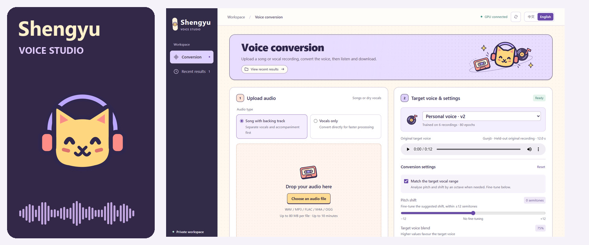
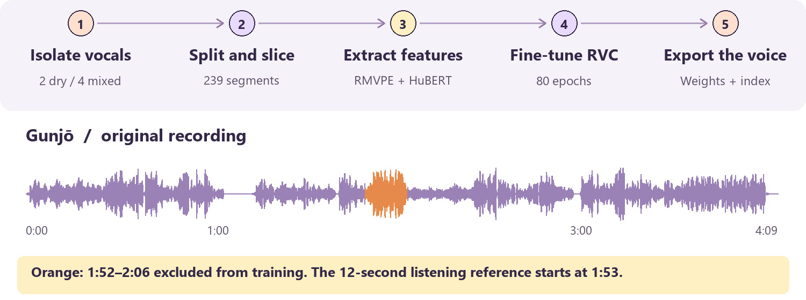
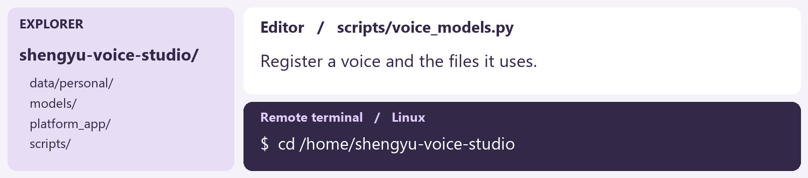
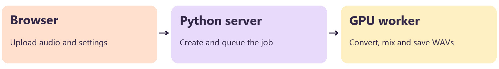
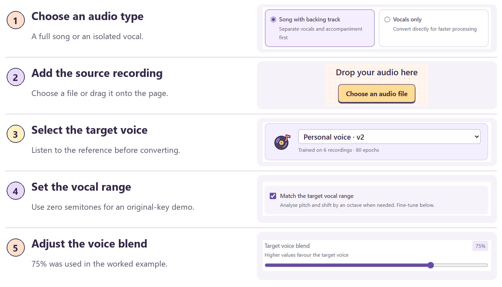
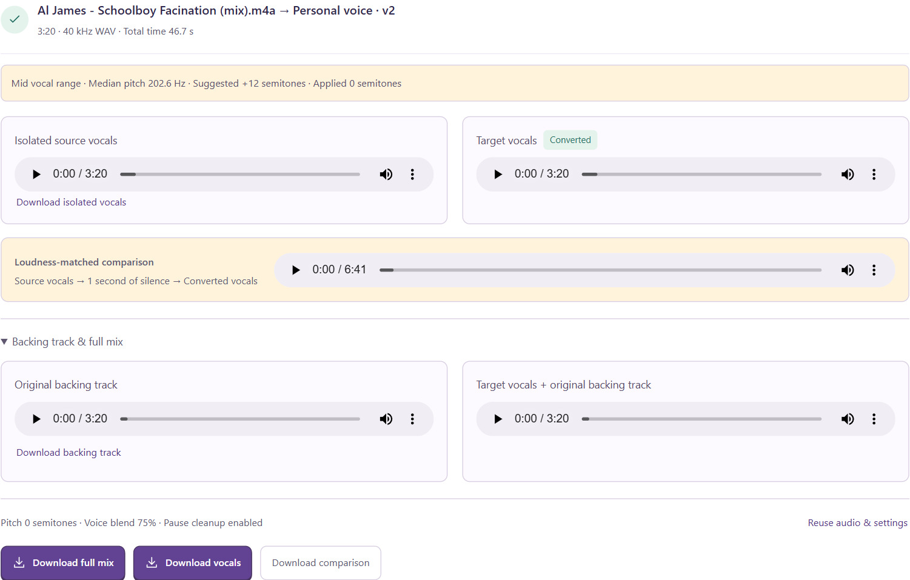
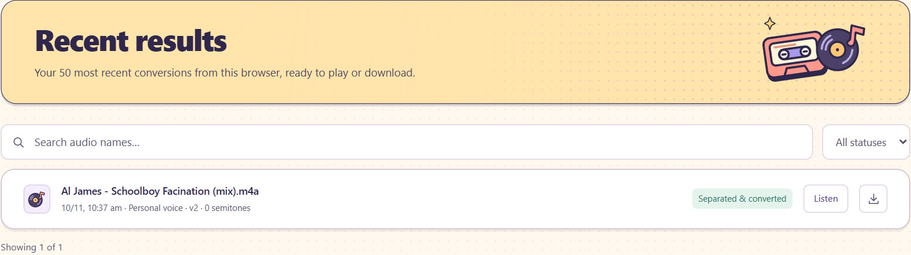

# Training and using a personal singing voice in Shengyu

[Download the illustrated Word guide](Shengyu-Voice-Studio-Guide-EN.docx?raw=1)

Shengyu lets a different singer perform a song in a voice we trained. The source recording supplies the words, melody and timing. The target model supplies the vocal timbre: the quality that helps us recognise who is singing. For a full song, we also keep the backing track and mix the new vocal back into it.



### A three-minute interview walkthrough

| Time | What to show | What to explain |
| --- | --- | --- |
| 0:00–0:40 | [The six recordings](#prepare-the-target-singers-recordings) | “We started with two isolated vocals and four songs with instruments. We wanted the model to learn the singer, so we separated the backing tracks first.” |
| 0:40–1:30 | [The five training steps](#how-the-model-learns-the-singers-voice) | “We kept a phrase for listening, learned the target voice from 239 short segments, then exported weights and a retrieval index.” |
| 1:30–2:15 | [The studio controls](#convert-a-song-in-the-browser) | “I can use the trained voice on a new song. I choose the recording type, select the target and decide whether to keep the original key.” |
| 2:15–3:00 | [The recorded result](#listen-to-the-worked-example) | “Listen to the same phrase before and after conversion. Then listen to the full mix to hear how the new voice sits against the instruments.” |

The worked example uses **Personal voice · v2**, trained on about **21 minutes 38 seconds** from one singer. The English interface figures reproduce an archived run in the deployed studio. To play its audio during an interview, open the running studio or a previously downloaded WAV.

## Prepare the target singer’s recordings

Choose recordings of the person whose voice you want to learn. A new song uploaded after training can be sung by someone else. Listen to the training files once and mark which ones contain instruments.

| Recording in the case study | What we used for training |
| --- | --- |
| Gunjō and Monster | These two recordings already contained isolated vocals. |
| A vocal performance extracted from video and Don’t Break My Heart | We used BS-RoFormer to estimate the vocal stem in each mix. |
| Kuroi Namida and Overprotected | We applied the same separation step and passed the vocal stems to the training pipeline. |

### Put all six files in one format

The training script reads lowercase `.wav` files from one directory. Each file must contain one channel sampled at 40,000 Hz. In a configured Linux environment, this FFmpeg example converts one M4A recording. Run it from the project root and repeat for the other files.

```bash
mkdir -p data/personal/my_singer
.venv/bin/ffmpeg -i "data/incoming/take01.m4a" -vn -ac 1 -ar 40000 \
  -c:a pcm_s16le "data/personal/my_singer/01_dry.wav"
```

For the commands below, name the two dry files `01_dry.wav` and `02_dry.wav`, and the four mixed files `03_song.wav` through `06_song.wav`. These are example names. If you use your own names, pass those exact names to the training command. The first file in alphabetical order should contain clear singing and run for more than 18 seconds so the script can reserve a reference phrase.

**Working on a laptop?** In a VS Code Remote–SSH window, drag the prepared WAV files from your local file manager into `data/personal/my_singer/` in the remote Explorer. The singer’s original performances stay outside the public repository.

## How the model learns the singer’s voice



1. **Isolate the singer.** Two dry recordings went straight into preparation. For the other four, BS-RoFormer estimated the vocals so instruments would contribute less to the examples.
2. **Reserve a phrase and slice the rest.** In Gunjō, the 12-second phrase from 1:53 to 2:05 became the listening reference. We excluded one extra second on either side. The program split the remaining material around pauses, breaking longer passages into roughly 3.7-second slices with 0.3 seconds of overlap. This run produced 239 training segments.
3. **Describe pitch and pronunciation.** Think of a singer holding “ah” and sliding upwards. RMVPE records how the note rises. HuBERT describes the changing speech sounds with 768 numbers per time step. The pipeline analyses 16 kHz copies and pairs the results with the matching 40 kHz training audio.
4. **Fine-tune RVC v2.** We started with pretrained 40 kHz weights. The generator tried to reconstruct target vocals using the extracted features and pitch. The discriminator compared generated and recorded audio. Reconstruction and adversarial losses guided the updates over 80 epochs, with eight segments per batch.
5. **Export the voice.** The generator weights capture the learned mapping. FAISS indexes the training features so conversion can retrieve examples of similar sounds. We also saved a pitch-range profile for automatic octave selection. The reference phrase lets a listener compare the result with the real singer.

**What the reference tells us.** It gives us an original voice sample that was excluded from training. A short phrase from the same recording session cannot, by itself, establish how well the model generalises to other singers or songs.

## Run the training job in VS Code

Install Microsoft’s **Remote – SSH** extension. Connect to your deployment’s VPN if required. In the Command Palette, choose **Remote-SSH: Connect to Host**, select the SSH host supplied by your administrator, then open the project folder. Use **Terminal → New Terminal** in that remote window. In our container the project directory is `/home/shengyu-voice-studio`.



**Before starting.** Use a GPU environment with the pinned RVC implementation and dependencies, the HuBERT and RMVPE assets, and the 40 kHz generator and discriminator base weights. Install the upstream mute samples and features in `third_party/RVC-WebUI/logs/mute/`. The four mixed recordings also need the separation weights and configuration. Choose an unused experiment name.

```bash
cd /home/shengyu-voice-studio
nvidia-smi
mkdir -p models reports third_party/RVC-WebUI/logs third_party/RVC-WebUI/assets/weights
ls third_party/RVC-WebUI/assets/pretrained_v2/f0{G,D}40k.pth
```

Once the GPU is free, run the following in the remote Bash terminal. Each `--separate` marks a mixed file. If all your recordings are dry, omit those four options.

```bash
nohup .venv/bin/python -u scripts/train_personal_voice.py \
  voice_demo_01 data/personal/my_singer --epochs 80 \
  --separate 03_song.wav --separate 04_song.wav \
  --separate 05_song.wav --separate 06_song.wav \
  >> reports/voice_demo_01.log 2>&1 &
tail -f reports/voice_demo_01.log
```

Press **Ctrl+C** to leave the log viewer. The background training process continues. After it finishes, run `ls -lh models/voice_demo_01/` to inspect the exported files.

## Connect the trained voice to the platform

| File in `models/voice_demo_01/` | How the studio uses it |
| --- | --- |
| `voice_demo_01.pth` | Loads the learned generator parameters for conversion. |
| `voice.index` | Retrieves similar target-singer features for the selected voice blend. |
| `voice_profile.json` | Supplies an estimated target range. The case-study pitch median was 354.7 Hz. |
| `reference.wav` | Plays the held-out 12-second recording in the target-voice panel. |
| `training.json` | Records the inputs, epochs, batch size and training-segment count. |

### Add the voice to the selector

In VS Code, open `scripts/voice_models.py`. Add this entry inside the existing `MODELS` dictionary. The paths are relative to the project root. Place the pitch profile beside the weights so the worker can discover it.

```python
'voice_demo_01': dict(
    name='My singing voice', speaker='Personal recordings',
    description='Trained on six recordings', epochs=80,
    weight='models/voice_demo_01/voice_demo_01.pth',
    index='models/voice_demo_01/voice.index',
    reference='models/voice_demo_01/reference.wav',
    reference_title='Held-out original phrase',
),
```



The page in `platform_app/static/` collects the settings. Its JavaScript uploads the audio to `/api/uploads`, submits the conversion to `/api/jobs` and checks progress. The Python backend in `platform_app/server.py` queues the task. The worker in `scripts/platform_worker.py` loads the chosen voice and writes the audio outputs. In the deployed studio, results and logs are grouped by task under `.platform/jobs/`.

## Deploy and open the studio

### Use the public Windows launcher with a GPU server

Download the source and extract the [model release packages](https://github.com/Voice26/shengyu-voice-studio/releases/tag/v1.0.0) into the project root. For the personal-v2 example, use `personal_20261110.zip` and, for full songs, `separation.zip`. Keep the archive directory structure and verify the checksums listed in the release. Add your own short `reference.wav` to the personal model folder for the preview and selector. The remote GPU installation needs compatible assets and the same model registration.

From the Windows project folder, run the setup and start scripts in PowerShell. Setup asks for your configured SSH host and remote Linux project directory. Open `http://127.0.0.1:7866/?lang=en` on that computer. Use `.\stop_platform.ps1` to stop its web service.

```powershell
.\setup_platform.ps1
.\start_platform.ps1
```

### Use the shared Linux container from the demonstration

The demonstration uses a prepared Linux GPU container with the inference environment, model assets, offline packages and service scripts already installed. Its configuration runs the worker on the server. From the project directory in this deployment, start the service and check its status:

```bash
cd /home/shengyu-voice-studio
bash start.sh
bash status.sh
tail -n 40 .platform/web.log
```

The Linux service wrappers belong to the prepared deployment. For a copy of that deployment with the bundled Python runtime, wheelhouse and setup script, run `bash setup.sh` before the first start. The host must expose its NVIDIA GPU to the container. After changing the Python model registry, let active jobs finish, run `bash stop.sh`, then start the service again.

**For the audience.** Connect the laptop to its assigned WireGuard tunnel and open the studio address supplied by the administrator, for example `http://YOUR-VPN-HOST:7866/?lang=en`. The browser handles uploads and playback. The server handles the audio processing. The public GitHub repository hosts the guide and downloads.

## Convert a song in the browser



1. **Choose the input type.** Select **Song with backing track** for a finished song, or **Vocals only** for unaccompanied singing. Drag in a file or select **Choose an audio file**. The limit is 80 MB and 10 minutes. The **Male vocal** and **Female vocal** examples let you try a dry recording immediately.
2. **Listen to the target.** Choose **Personal voice · v2** and play **Original target voice**. This is the recorded singer you will compare against, rather than the new song you uploaded.
3. **Choose the key.** With **Match the target vocal range** enabled, the worker compares the original pitch with shifts of one octave up or down. The manual slider can fine-tune the shift. To hear the new timbre in the original key, disable matching and set **Pitch shift** to zero.
4. **Choose the blend.** Start with **Target voice blend** at 75%. **Pause & onset cleanup** uses the source vocal to reduce noise in gaps while preserving quiet onsets and word endings. Under **Advanced settings**, lower consonant-protection values give stronger protection (0.5 disables it). The volume envelope runs from 0 for source dynamics to 1 for generated dynamics.
5. **Select Convert voice.** The job enters the queue. Once it finishes, the studio shows the source vocal, converted vocal and comparison. With a full-song input, it also provides the separated backing and the final mix.

## Listen to the worked example

We converted Al James’s *Schoolboy Facination* from the MUSDB18 test set. The input was a full mix. The source vocal had a median pitch of about 203 Hz, compared with about 355 Hz for the target. The program suggested raising the vocal by one octave. For this recorded run we selected **manual, 0 semitones**, with **75% voice blend**, so the timing and musical key were easy to compare.

**What happened after clicking Convert voice?** BS-RoFormer estimated the vocal and backing tracks. RMVPE supplied source pitch and HuBERT supplied content features. The index retrieved similar target features, and RVC generated the new vocal with the chosen weights. The worker cleaned pauses, matched levels and mixed the converted voice back with the backing. The exported stereo mix was about **3:20 at 40 kHz**.



| During the interview | What to play or download |
| --- | --- |
| Compare the timbre on the same phrase | **Loudness-matched comparison** plays the source, one second of silence, then the converted vocal. |
| Check an artefact in a pause | Play **Isolated source vocals** and the separated backing independently. A sound already present in the vocal stem can carry into the conversion. |
| Hear the song as a listener would | Play **Target vocals + original backing track**. Use **Download full mix** for the song, **Download vocals** for the isolated converted voice, or **Download comparison** for the before-and-after file. |

## Revisit results and answer follow-up questions



**Recent results** lists up to 50 tasks for the current browser. Search by part of the filename or filter by status. Open a completed task to listen or download. Choose **Reuse audio & settings** to return to the workspace, change one setting and compare the new output. If a job fails, open **View task log** to find the step that failed.

| Interview question | An answer grounded in this project |
| --- | --- |
| Why separate the backing first? | The model expects a vocal. Isolating it gives pitch estimation and conversion a cleaner input. It also preserves a backing track we can mix with the new voice. |
| What is the difference between weights and the index? | The weights generate the new voice. The index retrieves examples of similar sounds from the target singer to guide that generation. The blend control adjusts their contribution. |
| What did you check, and what remains uncertain? | We checked the output format and duration and prepared a loudness-matched listening comparison. This single example provides no numerical measure of singer similarity. Separation leakage and quiet consonants are useful places to listen for errors. |
| Why might an old result or a new model be missing? | Reopen the same address in the original browser for past tasks. For a new model, check its registry entry, weights, index and reference WAV, then restart the service to reload the entry. |

The training figures come from the six-record personal-v2 training record and its vocal-range profile. The worked song’s settings and output figures come from the archived conversion report. The interface screenshots use that record and the English version of the deployed studio.
